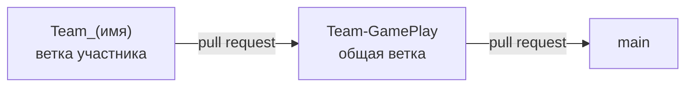

<div align="center">

# 🧪 Обеспечение качества и тестирование

**Командный проект по тестированию сайта [cpcimpex.com](https://cpcimpex.com)**

Учебная дисциплина · ВВГУ


</div>

---

## 📖 О проекте

Команда тестирует один сайт: каждый участник берёт свой блок страницы, пишет для него **тест-кейсы** и **автотест на Playwright**, а затем вливает работу в общую ветку через pull request и решает конфликты.

Объект тестирования: **[cpcimpex.com](https://cpcimpex.com)**, сайт компании по фасовке и упаковке товаров на контрактном производстве.

## 🗂 Что протестировано

| Блок сайта | Тест-кейсы | Автотест | Автор |
|---|---|---|---|
| 🃏 Карточки услуг | [`testing.md`](testing.md) · TC-01…TC-05 | [`cpcimpex.spec.js`](playwright-tests/tests/cpcimpex.spec.js) | Кирилл |
| 🔻 Футер | [`testing.md`](testing.md) · TC-F01…TC-F10 | [`cpcimpexFooter.spec.ts`](playwright-tests/tests/cpcimpexFooter.spec.ts) | Денис |

## 🐞 Найденные баги

| ID | Где | Что не так |
|---|---|---|
| BUG-F01 | Футер → «Топперы с начинкой под ключ» | Ссылка ведёт на `cpcimpex.com/https://toppers.cpcimpex.com/` и отдаёт **404** |
| — | Карточка «Топперы с начинкой под ключ» | На `https://toppers.cpcimpex.com` стоит чужой SSL-сертификат (`*.valuehost.ru`), браузер показывает ошибку вместо сайта |
| — | Весь сайт | Headless-браузеру сайт отдаёт **пустую страницу** (см. ниже) |

## 📁 Структура репозитория

```
.
├── README.md                 # вы здесь
├── testing.md                # все тест-кейсы команды в одном файле
└── playwright-tests/         # автотесты, готовые к запуску
    ├── playwright.config.ts
    ├── package.json
    ├── pages/                # Page Object’ы
    └── tests/                # *.spec.ts / *.spec.js
```

## 🚀 Быстрый старт

Нужен **Node.js 18+**.

```bash
git clone https://github.com/Plumbam/testing.git
cd testing/playwright-tests
npm install
npx playwright install chromium
npm test
```

| Команда | Что делает |
|---|---|
| `npm test` | Прогон всех тестов |
| `npm run test:ui` | UI-режим: тесты по шагам со снимками страницы |
| `npm run test:headed` | Прогон с видимым браузером |
| `npm run report` | HTML-отчёт после прогона |

## 🔀 Как мы работаем с git



1. Каждый участник делает свою ветку от `Team-GamePlay`: `Team_(имя)`.
2. Тест-кейсы дописываются в общий [`testing.md`](testing.md), автотест кладётся в [`playwright-tests/tests/`](playwright-tests/tests/).
3. Работа вливается в `Team-GamePlay` через pull request, конфликты решаются там же.
4. Готовая `Team-GamePlay` вливается в `main`.

## ⚠️ Важно: сайт блокирует headless-браузер

В headless-режиме Chromium отправляет заголовки `User-Agent` и `sec-ch-ua` со словом `HeadlessChrome`, и на такие запросы cpcimpex.com отвечает **пустой страницей**. В [`playwright.config.ts`](playwright-tests/playwright.config.ts) оба заголовка подменены на обычный Chrome, поэтому свои тесты стоит запускать именно через этот конфиг.
